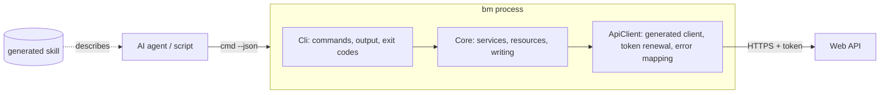
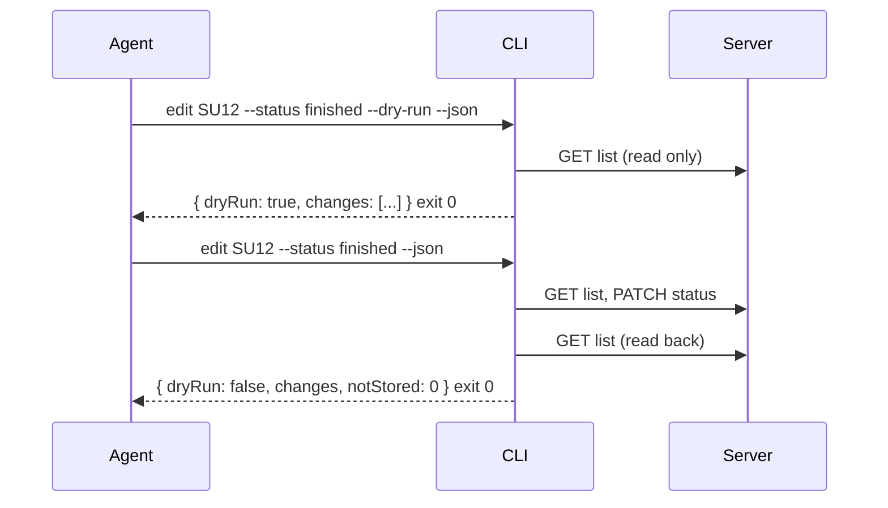

# Agent-first CLI for a web app

A command line client that an AI agent (or a script) can use instead of the web UI: every command has a stable JSON
output and stable exit codes, things are addressed by short ids, writes are checked before they are sent, and the
client ships its own agent skill. It is a first-class client next to the web app, not a debugging tool.

## How it works

### Why a CLI and not "just the API"

An agent could call the REST API directly, but a CLI gives it things a raw API does not:

- **A small, learnable surface.** `tool <area> <verb>` with built-in `--help`, instead of an OpenAPI document with
  hundreds of paths. The generated skill lists every command, option and JSON shape.
- **Authentication handled once.** Sign in once; the token is stored encrypted and added to every call. The agent never
  sees or types a token.
- **Safety rules in one place.** Secrets the API happens to return are removed, writes have a `--dry-run`, hardware
  control is not exposed.
- **Speed.** Every call is a new process, so start-up time is the user experience. A Native AOT binary answers in
  about 30 ms.

### The contract

| Rule | Why |
|---|---|
| `--json` on **every** command: one JSON document on stdout, errors on stderr as JSON | an agent parses instead of guessing |
| Human text, help and colors never appear in `--json` output | no mixed streams |
| Stable exit codes: `0` ok, `1` error, `2` usage (nothing changed), `3` not signed in, `5` unreachable, `130` cancelled | an agent branches on the code before it parses |
| No terminal needed: missing input is exit code 2 naming the option or variable; secrets via stdin or environment, never as arguments | agents have no TTY |
| Enumerations as names (`ready`, `keg-20l`), not numbers | readable and stable |
| Colored text minus escape codes equals the plain text | color never carries information |

### Short ids

Names are not unique (two batches can have the same name) and GUIDs are unreadable. The server numbers every
addressable thing with a running integer **next to** its GUID key, and the CLI shows a type prefix plus the number:
`SU12` (batch), `RE5` (recipe), `FA3` (keg). `view SU12`, `view su12` and `view 12` are the same; a wrong prefix is a
usage error that names the right one. The prefix is a short word in the language of the users (here German: Sud,
Rezept, Fass), unique per type. Lists show the id in the first column and `--json` carries `id` (GUID), `ref`
(`SU12`) and `objectNumber`.

Numbering on the server: SQLite only auto-increments the integer primary key, so with GUID keys the number is
assigned in `SaveChanges` as `max + 1` per table, protected by a unique index and one retry. Trade-off: the highest
number can be reused if the newest row is deleted. A counter table avoids that at the price of one more write; choose
it if ids are remembered outside the system.

### Reading

One definition per resource (columns, sort fields, filters, detail fields, id prefix) produces `list` and `view`, so all
areas behave and look alike. Lists are cut by the CLI (30 rows as text, 100 with `--json`, no "all"); agents narrow
with filters. Answers are read as JSON, not through generated models, so a property the model does not know cannot
break a command. Secrets are removed on reading (password hashes, e-mail addresses, device tokens and
configuration), because an API often embeds whole user records where nobody expects them.

### Writing

The rules, copied from a mature agent CLI (`tasks edit`):

1. `--dry-run` resolves and checks everything, shows current and new value, **sends nothing**.
2. Everything is checked and resolved **before the first request**; a typo or an unknown name is exit code 2 and
   nothing changed.
3. A value that is already set is not sent (`Nothing to change`).
4. The object is **read again afterwards**; the output shows what the server stored. A change the server accepted but did
   not store is a warning and counted (`notStored`).
5. The JSON result always has `dryRun`, so an agent can run the same command twice: first with `--dry-run`, then for
   real.
6. Read the server handler before writing a command: what does the request overwrite (APIs often replace whole objects,
   so send the current value of everything not edited), what does it log, what does it delete silently. Anything
   destructive that the server decides by a flag needs an **explicit option** in the CLI (example: linking a device may
   delete its buffered readings, so `--readings assign|discard` is mandatory when there are any).
7. Do not offer what the CLI cannot do safely: if saving an object would erase fields the CLI never reads (tokens,
   configuration), the object is not editable from the CLI.
8. Never control hardware; never touch production without explicit approval.

### Architecture

- `Cli` binds arguments, calls a service and formats; nothing else. Everything it needs from outside (input,
  environment, clock, HTTP) comes from one context object, so tests run commands in-process against fakes.
- `Core` has no console: auth, settings, the list/view/edit building blocks, write services.
- `ApiClient` holds the **generated** client (never edited by hand), one request pipeline, token renewal and error
  mapping. Reading the error body of every 4xx/5xx matters because controllers often return `{ "message": ... }`
  objects the generator does not know.

### Technology stack (and why)

| Area | Choice | Reason |
|---|---|---|
| Language | .NET 10 (C#) | same stack as the server; shared knowledge |
| Distribution | **Native AOT**, one native exe (about 12 MB) | start-up about 30 ms instead of 100+ ms; nothing to install besides the file. See the [packaging guide](../../../guides/development/ci/native-aot-cli-velopack-chocolatey.md) |
| Command line | System.CommandLine | subcommands, help, parse errors |
| Output | Spectre.Console for tables and panels; plain `--json` for machines | readable for people, parseable for agents |
| API client | Kiota C# client **generated from the server's OpenAPI document** | a new endpoint is one regeneration away; never edited by hand |
| Auth | JWT access token, refresh code in place but idle until the server supports it; token file encrypted (Windows DPAPI) behind an interface; cross-process lock file | sign in once, parallel agent calls are safe |
| Tests | xUnit, commands run in-process against a fake server that records every request | assert requests, dry runs and usage errors; no real server |
| Packaging | Velopack installer, portable zip, Chocolatey package | see the guide |
| Agent skill | generated by the binary | see [Generating an agent skill from the CLI itself](../../../guides/ai/tooling/generated-agent-skill-for-a-cli.md) |

Native AOT rules for all code: no reflection-based serialization (source-generated JSON contexts, `JsonNode` for documents
built at run time), no dynamic assembly loading; the publish step fails on any trim/AOT warning.

### The parity rule

The CLI only stays useful if it keeps up with the product. Write the rule into the repository's agent guidance: **when
functionality is added to or changed in the backend or the web app, the same functionality is added to or changed in the
CLI in the same change**, or an issue for the CLI part is opened and linked. List the deliberate exceptions so nobody
wonders (pure UI, hardware control, user and permission administration, file uploads, whole-database import/export,
internal jobs) and document them as "not available" for users. A checklist in a repo skill (decide, ids, read side, write
side, generated-skill registration, tests, docs) makes the rule cheap to follow; a test that fails when a command is not
registered in the generated skill makes it hard to forget.

## When to use it / trade-offs

- Worth it when agents or scripts should operate an application that already has a web UI and a documented API.
- Cost: every feature has to be mirrored (the parity rule), and business logic that lives only in the frontend (for
  example a recipe-scaling calculation) must be duplicated or moved to the server. Moving it to the server is cleaner.
- Native AOT limits libraries (reflection) and needs a C++ toolchain on the build machine; a framework-dependent
  single-file publish is the fallback if that is too much.

## Pitfalls

- **Generated client models can be wrong.** Numbers declared as "integer or string" become untyped nodes; fix the
  server's OpenAPI output (strict number handling for the document) instead of working around it in the client. An enum
  schema the generator does not understand becomes an empty class; build that request body as JSON.
- **APIs leak.** Embedded user entities in list answers carried password hashes. Strip secrets on reading in one place.
- **`localhost` can cost seconds.** Resolving `localhost` tries IPv6 first on Windows; use `127.0.0.1` as the local
  default.
- **Whole-object updates erase fields.** If the CLI does not read a field (token, configuration), it must not save an
  object that contains it.
- **Silent destructive defaults.** A boolean flag in the server request that deletes data when false must become a
  mandatory choice in the CLI.
- **Tests must not use a real server.** A fake that records method, URL and body lets you assert that a dry run only
  sent GET requests.

## Related

- [Generating an agent skill from the CLI itself](../../../guides/ai/tooling/generated-agent-skill-for-a-cli.md)
- [Packaging a .NET Native AOT CLI with Velopack and Chocolatey](../../../guides/development/ci/native-aot-cli-velopack-chocolatey.md)
- [Coding-agent CLI as a sub-agent vs. as a model provider](coding-agent-cli-subagent-vs-provider.md)
- [Building an OpenClaw agent skill](../../../guides/ai/tooling/openclaw-skill-development.md)
- [LLM wiki concept](wiki-llm-concept.md)

## Sources

- [Original notes (private)](../../../../../sources/ai/tooling/2026-10-25-agent-first-cli-concept.md)
