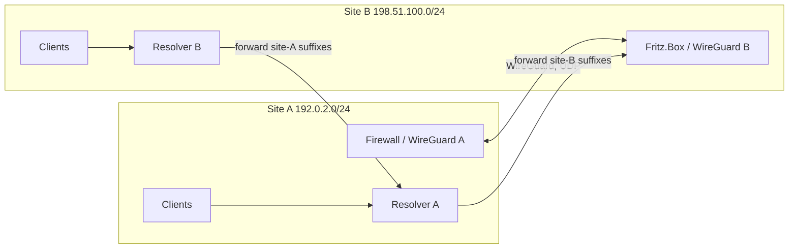

# WireGuard site-to-site with a Fritz.Box: split DNS and path MTU

Two home networks can be joined with a WireGuard tunnel so that every device in one network reaches
every device in the other — without any client software. A Fritz.Box (FRITZ!OS 7.5+) can act as one
end natively ("network connection"), a firewall such as OPNsense as the other. The tunnel itself
is the easy part; what usually goes wrong is **name resolution** and, less often, **packet size**.

## How it works

- **Peering.** Each side lists the other's LAN as the peer's *allowed IPs* (Fritz.Box: "remote
  network"). WireGuard routes by allowed IPs, so the two LANs must not overlap. Only the networks
  you want reachable go in; leave "send all traffic through the VPN" **off** if the tunnel should
  carry no internet traffic.
- **Who connects.** Only one side needs a reachable address. If a side has a dynamic IP, point the
  other end at its dynamic-DNS name (a Fritz.Box offers a `myfritz.net` name). The side that dials
  out needs no port forward; a keepalive (25 s) keeps NAT mappings and the endpoint fresh. If the
  endpoint is a DNS name that changes, see
  [WireGuard endpoint DNS re-resolve](wireguard-dns-reresolve.md).
- **Routing.** The Fritz.Box side is normally the default gateway of its LAN, so its devices need no
  extra route; the Fritz.Box adds the remote network itself. On the firewall side add a firewall
  rule per direction you want (site A → B, B → A), otherwise packets are routed but dropped.
- **Typical firewall assignment.** On OPNsense, assigning the WireGuard instance as an interface
  lets you write rules per interface; a pass rule on the WireGuard *group* covers all instances.
  See [WireGuard on OPNsense](../../../guides/network/vpn/wireguard-on-opnsense.md).

### Split DNS

Reaching devices by IP works as soon as the tunnel is up. *Names* do not: each site's resolver only
knows its own names, and the Fritz.Box as a DHCP-advertised resolver knows none of the other site's.
The reliable pattern when both sites run their own resolver (e.g. AdGuard Home or Unbound):

1. **Advertise your own resolver by DHCP** at each site, not the router (on a Fritz.Box:
   Home Network → Network → Network Settings → Advanced → IPv4 → "Local DNS server").
2. **Forward the other site's domain suffixes** to the other site's resolver, using per-domain
   upstreams (`[/suffix/]<resolver-ip>` in AdGuard Home's `upstream_dns`). Keep one site as the
   *source of truth* for shared names so the same wildcard does not resolve differently on each
   side — a stale copy of a rewrite on the other side is a classic bug.
3. **Keep the router's own names reachable**: forward the router suffix (e.g. `fritz.box`) to the
   router.
4. **Do not rely on the peer's "DNS domains" list** in the Fritz.Box peer settings unless you have
   no resolver of your own; it only affects the Fritz.Box's own lookups.
5. **Give the resolver host a fallback** (router as second nameserver) so a stopped resolver
   container does not cut the host off — if the host takes its DNS from DHCP, set it with a
   `supersede domain-name-servers …;` line in `dhclient.conf`, because plain `/etc/resolv.conf`
   edits are overwritten at lease renewal.

DHCP clients only take a changed DNS server when their lease renews (hours to days); a reconnect
speeds it up.

### Path MTU

A WireGuard tunnel adds ≈60–80 bytes per packet, so the tunnel MTU is typically 1420 on a 1500
path. Paths can be asymmetric: in one measured case one direction passed 1420-byte IP packets while
the other only passed ≈1350, silently (no ICMP "fragmentation needed", or a wrong value in it).

- **Measure:** do a DF ping sweep (`ping -M do -s <size>` on Linux, `ping -f -l <size>` on Windows;
  packet size = payload + 28) in *both* directions to find the largest passing size.
- **TCP vs the rest:** TCP is usually safe because the Fritz.Box (and optionally the firewall)
  clamps the MSS — check a live connection with `ss -tin` (`mss:` well below 1460 means clamped) and
  run a real multi-MB upload. Only larger UDP/ICMP, nested tunnels and some QUIC traffic suffer.
- **Fix only if it matters:** clamp the MSS on the tunnel interface of the firewall, or lower the
  WireGuard MTU on the side that sends too-large packets. If the drop happens *before* the packet
  reaches your firewall, the firewall cannot fix it.

## When to use it / trade-offs

- **Good for:** reaching devices and shares (NAS backup, home automation) in a second location;
  needs no software on clients and survives device changes.
- **Not for:** forwarding internet traffic through the other site (leave send-all off), or
  overlapping address ranges (renumber first).
- **Single points of failure:** one resolver per site, and one tunnel. If the tunnel is down, a
  site's resolver cannot answer the other's names — decide what the fallback should be.

## Pitfalls

- Browsing a Fritz.Box UI with deep links or an automation `navigate` discards the session (the
  session ID lives in page memory); log in and click through the menu.
- The Fritz.Box cannot disable a static route — only edit or delete it; note the values first.
- Printing peer lists through a firewall API leaks private and pre-shared keys into logs; filter to
  name, status and handshake.
- A site that has no real resolver of its own (router-only) ends up resolving the other site's names
  nowhere — fix DHCP DNS first, then forwarding.
- Stale rewrites copied to the second resolver diverge silently; forward the suffix instead of
  copying records.

## Related

- [WireGuard endpoint DNS re-resolve](wireguard-dns-reresolve.md)
- [WireGuard on OPNsense](../../../guides/network/vpn/wireguard-on-opnsense.md)

## Sources

- [Original session notes (private)](../../../../../sources/network/vpn/2026-11-06-wireguard-site-to-site-fritzbox-opnsense.md)
