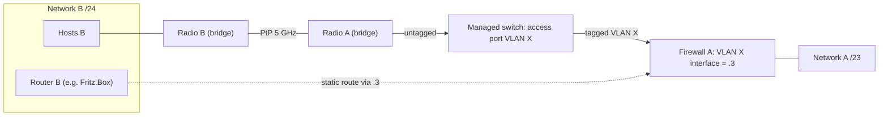

# Joining two LANs over a point-to-point radio bridge without merging them

Two neighbouring home networks (each with its own router, DHCP and DNS) can be linked with a pair of
point-to-point (PtP) radio bridges, e.g. Ubiquiti airMAX units. Plugged in naively, the radios form
one big layer-2 network — two DHCP servers, shared broadcasts. The pattern below keeps the networks
separate and routed, exactly like a site-to-site VPN, but with radio latency and bandwidth.

## How it works

- **Both radios in bridge mode, PtP mode on.** They act like a long cable. No routing, NAT or
  firewalling on the radios.
- **Network B is extended over the radio into a dedicated VLAN on side A.** The radio on side A plugs
  into an **access port** (untagged, PVID = VLAN X, "untagged only") of a managed switch; the uplink
  carries VLAN X tagged to the firewall.
- **Firewall A gets one leg in network B** (`<ip-b>.3` on the VLAN X interface). It routes between A and
  B and enforces the rules for traffic from B.
- **Router B gets a static route** `<ip-a> via <ip-b>.3`. Hosts in B keep router B as their default
  gateway; router B forwards A-bound traffic to the firewall's leg.
- Network A never sees B's broadcasts untagged; only routed unicast crosses between the networks.
  B's own broadcasts (ARP, mDNS, …) do cross the radio and end at the firewall's VLAN interface — a few
  kbit/s.

## When to use it / trade-offs

- **vs. a VPN between the two internet lines:** latency drops from ~10 ms to 1-2 ms, throughput is
  limited by the radio (hundreds of Mbit/s) instead of the slower upload, and the full 1500-byte MTU
  is available (no tunnel overhead).
- **Access port vs. tagging on the radio:** letting the switch assign the VLAN makes the isolation
  independent of the radio's config — a factory-reset radio cannot merge the networks. Tagging on the
  radio works too, but then a reset radio puts network B straight into network A.
- **Router on the firewall vs. router on the radio:** some radio firmware deprecates router mode in
  PtP (airOS 8.7 warns "PTP router mode is deprecated"), routing on the radio's small CPU limits
  throughput, and firewall rules end up split across devices.
- Keep the old VPN configured as a fallback: switching back is "disable the VLAN leg + re-enable the
  VPN routes on side A" and "deactivate the static route on side B" — do both together.

## Pitfalls

- **PtP does not filter broadcasts.** PtP is only the radio scheduling mode. A radio in bridge mode on
  a LAN port floods the whole LAN's broadcast/multicast over the air.
- **Forgotten managed switches drop tagged frames.** A web-managed switch left on factory settings is
  often 802.1Q with only VLAN 1 and drops unknown VLAN IDs at ingress — it looks like an unmanaged
  switch for untagged traffic. Find it by testing tagged frames hop by hop and by moving devices to
  other switches; then add the VLAN explicitly (there is often no "VLAN off" mode).
- **Positive controls must be real.** "VLAN Y already works" is only a control if VLAN Y actually
  carries traffic today — check the firewall's interface counters.
- **Capturing VLAN traffic:** tcpdump's `arp` filter does not match ARP inside an 802.1Q tag; filter by
  MAC (`ether host`). Unicast between two LAN hosts never passes the firewall port, so validate a
  capture with broadcasts.
- **Connected route vs. VPN route:** giving the firewall's VLAN leg an address in network B creates a
  connected route that beats the VPN's route for the same prefix. Create the VLAN interface early,
  but add the address only at the cut-over (use a documentation-range test address like
  `192.0.2.1/24` meanwhile).
- **Policy routing on the firewall:** if LAN rules route by source group through gateway groups, only
  traffic matching an exception rule without a gateway uses the routing table. Ping may work (a broad
  ICMP rule) while TCP leaves via the WAN. Every destination network behind the radio needs such an
  exception.
- **Cut over both ends together.** Changing only side A's routing while side B still answers via the
  VPN creates asymmetric routing; a stateful firewall drops it, and you may lose access to side B's
  admin UI. Change side B's route first (while you can still reach it), then side A immediately.
- **Check that side B's static route is actually active.** Some routers (e.g. Fritz.Box) have a "route
  active" checkbox; a listed but inactive route looks like it exists.
- **Remote radio config changes need a dead-man switch.** Apply in a non-persistent "test" state,
  arm a timed reboot that loads the saved config unless confirmed, verify, then save.
- **Auto channel can land on a weather-radar DFS channel** after a reboot: 10 minutes of channel
  availability check (CAC) with the link down. Pin a channel with a short CAC.
- **Firmware updates on old airOS:** older builds only offer `ssh-rsa` host keys (enable it per
  connection); airOS has no `nohup`, so run `fwupdate -m` in the foreground and let the session drop.

## Related

- [WireGuard site-to-site with a Fritz.Box: split DNS and path MTU](../vpn/wireguard-site-to-site-split-dns-and-mtu.md) — the VPN variant of the same link, still useful as fallback

## Sources

- [Original session record (private)](../../../../../sources/network/wifi/2026-11-06-radio-bridge-vlan-cutover.md)
- [airOS 8.7.25 changelog](https://dl.ui.com/firmwares/XC-fw/v8.7.25/changelog.txt)
