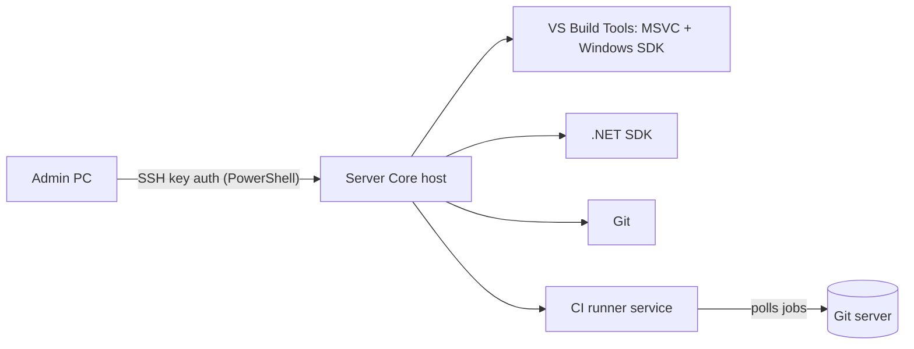

# Windows Server Core build server for MSVC / Native AOT

Plan for a headless Windows Server 2025 (Server Core, no desktop experience) that builds
.NET projects with **Native AOT**. Native AOT needs the MSVC linker and the Windows SDK, so the
host needs the Visual Studio **Build Tools** (C++ workload) — not the full IDE. Everything is
done remotely over SSH/PowerShell after a short console bootstrap.

> [!note] Status
> Steps 1-8 and the Native AOT check were executed successfully on a real host (VS 2026 Build Tools, .NET 10). Items still marked **(verify)** are unconfirmed.



## Prerequisites

- Windows Server 2025 installed as **Server Core** (no desktop experience), activated or in evaluation.
- Static IP or a DHCP reservation; DNS name `<hostname>`.
- Local administrator access on the console (VM console / hypervisor) for the bootstrap only.
- Sizing: 4+ vCPU, 8+ GB RAM (linking Native AOT is memory-hungry), 120+ GB disk (Build Tools with C++ and SDK ≈ 10–15 GB, plus NuGet cache and build output).
- An SSH key pair on the admin PC (`ssh-keygen -t ed25519`).

## Steps

### 1. Bootstrap on the console

Server Core boots into a command prompt that starts `sconfig`. Use it (or the equivalent
PowerShell) for the minimum needed to reach the machine remotely:

```powershell
# Rename and set a stable address (or use a DHCP reservation instead)
Rename-Computer -NewName <hostname> -Restart
New-NetIPAddress -InterfaceAlias "Ethernet" -IPAddress <ip> -PrefixLength 24 -DefaultGateway <gateway>
Set-DnsClientServerAddress -InterfaceAlias "Ethernet" -ServerAddresses <dns>

# Time zone
Set-TimeZone -Id "W. Europe Standard Time"
```

### 2. Enable OpenSSH Server

Windows Server 2025 ships the OpenSSH server component; it only has to be started **(verify
whether it is preinstalled on the build in use; otherwise `Add-WindowsCapability -Online -Name OpenSSH.Server~~~~0.0.1.0`)**.

```powershell
Set-Service sshd -StartupType Automatic
Start-Service sshd
# Firewall rule is normally created automatically; check:
Get-NetFirewallRule -Name *ssh* | Select-Object Name, Enabled, Direction

# Use PowerShell as default SSH shell
New-ItemProperty -Path "HKLM:\SOFTWARE\OpenSSH" -Name DefaultShell `
  -Value "C:\Windows\System32\WindowsPowerShell\v1.0\powershell.exe" -PropertyType String -Force
```

### 3. Key-based login for administrators

Members of the local Administrators group use `C:\ProgramData\ssh\administrators_authorized_keys`
(not the profile's `.ssh` folder). The file needs strict ACLs or sshd ignores it.

```powershell
$f = "C:\ProgramData\ssh\administrators_authorized_keys"
Set-Content -Path $f -Value "<public key line>" -Encoding ascii
icacls $f /inheritance:r /grant "Administrators:F" /grant "SYSTEM:F"
```

Then disable password logins in `C:\ProgramData\ssh\sshd_config`
(`PasswordAuthentication no`) and `Restart-Service sshd`, **only after** a key login works.

From the admin PC: `ssh <user>@<hostname>`.

### 4. Optional: WinRM / PowerShell remoting

SSH is enough for everything below. WinRM (`Enable-PSRemoting`) is only needed for tooling that
requires it (e.g. `Invoke-Command` in existing scripts). Prefer HTTPS or a trusted network.

### 5. Windows Update and hygiene

```powershell
sconfig            # option 6: download and install updates (interactive), or:
Install-Module PSWindowsUpdate -Force
Get-WindowsUpdate -Install -AcceptAll -AutoReboot
```

Plan a recurring update window; a build server that is never patched becomes the weakest host.

### 6. Install Visual Studio Build Tools (C++ for Native AOT)

Download the bootstrapper (the `aka.ms` link for the current major version; **(VS 2026 = `18/stable`; VS 2022 = `17/release`. Note `18/release` does not exist)**) and install headless:

```powershell
$dir = "C:\Setup"; New-Item -ItemType Directory -Force $dir | Out-Null
Invoke-WebRequest https://aka.ms/vs/18/stable/vs_BuildTools.exe -OutFile "$dir\vs_BuildTools.exe"

& "$dir\vs_BuildTools.exe" --quiet --wait --norestart --nocache `
  --installPath "C:\BuildTools" `
  --add Microsoft.VisualStudio.Workload.VCTools `
  --includeRecommended `
  --add Microsoft.VisualStudio.Component.Windows11SDK.26100
echo $LASTEXITCODE   # 0 = ok, 3010 = ok but reboot required
```

- `Microsoft.VisualStudio.Workload.VCTools` ("Desktop development with C++") is what Native AOT
  requires: MSVC toolset, linker, Windows SDK, CRT.
- Add `Microsoft.VisualStudio.Component.VC.Tools.ARM64` to cross-compile `win-arm64`.
- Add `Microsoft.VisualStudio.Workload.MSBuildTools` / `NetCoreBuildTools` only if classic MSBuild
  projects are built as well.
- Component IDs: <https://learn.microsoft.com/visualstudio/install/workload-component-id-vs-build-tools>.

### 7. Install the .NET SDK

```powershell
Invoke-WebRequest https://dot.net/v1/dotnet-install.ps1 -OutFile C:\Setup\dotnet-install.ps1
C:\Setup\dotnet-install.ps1 -Channel 10.0 -InstallDir "C:\Program Files\dotnet"
[Environment]::SetEnvironmentVariable("DOTNET_CLI_TELEMETRY_OPTOUT", "1", "Machine")
```

Install every SDK channel the projects need side by side (check each project's `global.json`).

### 8. Install Git

Git for Windows (silent installer, `/VERYSILENT /NORESTART`) or MinGit. Needed by CI runners and
for `git describe`-based versioning.

### 9. Install a CI runner as a service (optional)

Gitea `act_runner` or the GitHub Actions runner, registered with a token, installed as a Windows
service running under a **dedicated low-privilege account** (not Administrator). Keep the work
directory on a separate path, e.g. `D:\work`, and clean it regularly.

### 10. Hardening and housekeeping

- Defender: add exclusions for the build/work directory and `C:\Users\<runner>\.nuget` to speed up builds (accept the trade-off consciously).
- Disable RDP unless needed; keep SSH as the only management path.
- Back up: the VM (hypervisor snapshot or backup job) plus the runner config. Build output is reproducible and does not need backup.
- Document every manual change on the entity page for the host.

## Verify

```powershell
# MSVC present? (vswhere ships with the installer)
& "${env:ProgramFiles(x86)}\Microsoft Visual Studio\Installer\vswhere.exe" -products * -latest -property installationPath
dotnet --info

# Native AOT smoke test
dotnet new console -o C:\Temp\aottest
cd C:\Temp\aottest
dotnet publish -r win-x64 -c Release -p:PublishAot=true
.\bin\Release\net10.0\win-x64\publish\aottest.exe
```

A successful publish produces a single native `.exe` with no `.dll` runtime dependencies. The
error `Platform linker not found` means the C++ workload or Windows SDK is missing.

## Troubleshooting

- **`Platform linker not found` / `link.exe` missing:** the VCTools workload is not installed or the build does not run inside a developer environment; re-run the installer with `--add Microsoft.VisualStudio.Workload.VCTools`.
- **Long installs die with the SSH session:** run the installer as a scheduled task as SYSTEM (`Register-ScheduledTask` + `Start-ScheduledTask`) and poll its state.
- **Installer fails with `0x8007045B`:** a restart is in progress, typically the second reboot after a cumulative update; wait for it and retry.
- **Installer exits with 3010:** success, reboot required.
- **SSH key ignored:** wrong ACLs on `administrators_authorized_keys`, or a user in Administrators while the key sits in the user profile.
- **Installer hangs:** it often waits for a reboot or a pending update; check `%TEMP%\dd_*.log`.

## Related

- Private host page: see the build server entity in the private wiki (not linkable from here).

## Sources

- Microsoft Learn: [Visual Studio Build Tools component IDs](https://learn.microsoft.com/visualstudio/install/workload-component-id-vs-build-tools)
- Microsoft Learn: [Native AOT deployment](https://learn.microsoft.com/dotnet/core/deploying/native-aot/)
- Microsoft Learn: [OpenSSH server configuration for Windows](https://learn.microsoft.com/windows-server/administration/openssh/openssh-server-configuration)
